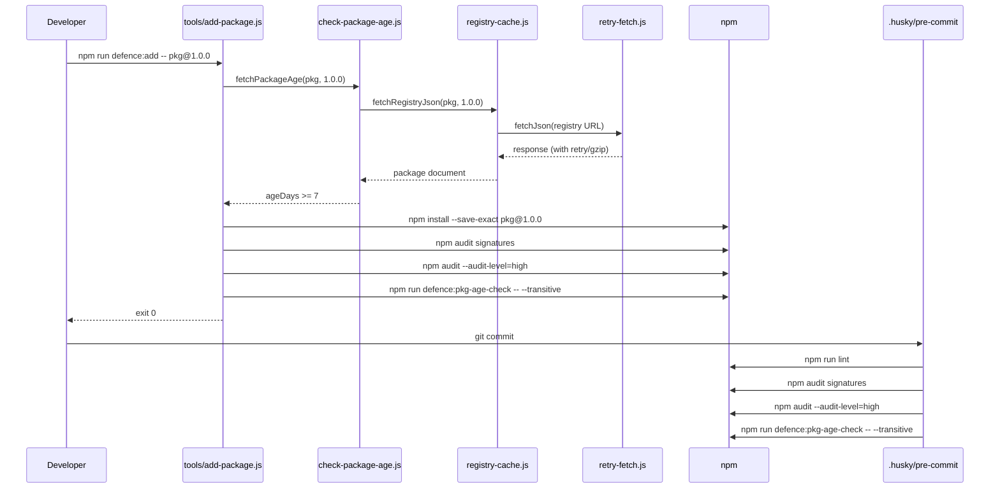

# Architecture

This document describes the high-level architecture of the project: how the files, scripts, security layers, and AI customizations fit together.

## Repository Layout

```bash
.
├── .github/
│   ├── copilot-instructions.md       # Always-on AI instructions (≤ 3 KB, budget enforced)
│   ├── instructions/                 # File-scoped AI instructions (applyTo patterns)
│   ├── agents/                       # Custom AI agents (+ agents.sanity.test.js)
│   ├── skills/                       # Agent Skills (+ skills.sanity.test.js, generated index)
│   ├── hooks/                        # Copilot lifecycle hooks (+ hooks.sanity.test.js, scripts/)
│   ├── workflows/ci.yml              # GitHub Actions CI pipeline (12 jobs)
│   ├── CODEOWNERS                    # Organizational defense: code-owner review on critical paths
│   ├── PLAN.md                       # Authoritative plan (source of truth for sessions)
│   ├── ai-lessons-learned.md         # Recurring AI mistakes log
│   └── ISSUE_TEMPLATE/               # Issue forms, including AI tool gap reports
├── .husky/
│   ├── pre-commit                    # Git hook executed on every commit (hash-protected)
│   └── post-merge                    # Hook that warns when node_modules is stale
├── .npmrc                              # Hardened npm defaults (guarded by check-npmrc)
├── .nvmrc                              # Pinned Node.js version (managed by update-engines)
├── .defence-manifest.json              # SHA-256 manifest of adopted defence files
├── biome.json                          # Biome lint and format configuration
├── package.json                        # Project manifest and npm scripts
├── package-lock.json                   # Deterministic dependency tree
├── README.md                           # Entry point documentation
├── CHANGELOG.md                        # What changed (Keep a Changelog)
├── CONTRIBUTING.md                     # Contributor workflow and commit granularity rule
├── DECISIONS.md                        # ADRs — why paths were chosen
├── SECURITY.md                         # Security policy
├── TODO.md                             # Checkbox tracker mirroring PLAN.md
├── docs/                               # Multilingual documentation (en, pt-BR)
└── tools/                              # Defence scripts and tests
    ├── add-package.js                #   controlled npm install wrapper
    ├── analyze-lifecycle-scripts.js  #   lifecycle-script risk analysis
    ├── check-dead-code.js            #   advisory dead-code candidate finder
    ├── check-engines.js              #   runtime vs engines validation
    ├── check-external-urls.js        #   external URL reachability
    ├── check-hooks.js                #   pre-commit integrity (hash)
    ├── check-licenses.js             #   license allow/deny lists
    ├── check-lockfile-integrity.js   #   lockfile hash strength
    ├── check-md-links.js             #   markdown link validation
    ├── check-npmrc.js                #   npm configuration surface guard
    ├── check-package-age.js          #   minimum package age
    ├── check-secrets.js              #   secret scanning
    ├── check-sync.js                 #   node_modules vs lockfile sync
    ├── check-updates.js              #   update classification (eligible/quarantine)
    ├── generate-sbom.js              #   CycloneDX SBOM
    ├── generate-trust-report.js      #   dependency trust scoring
    ├── install-defences.js           #   adoption installer + manifest
    ├── integration.test.js           #   cross-tool integration tests
    ├── monitor-install.js            #   monitored install wrapper
    ├── run-audit-with-retry.js       #   npm audit with transient-retry
    ├── setup-bootstrap.js            #   first-install bootstrap
    ├── update-badge.js               #   README test-count badge
    ├── update-engines.js             #   engine update/upgrade (dist-index gated)
    ├── update-packages.js            #   controlled npm update wrapper
    ├── verify-defences.js            #   manifest verification
    ├── e2e/                          #   end-to-end harness (repo-local, not adopted)
    ├── perf/                         #   benchmarks and baselines
    └── lib/                          #   shared modules (single responsibility each)
        ├── concurrency.js            #     bounded-concurrency runner
        ├── config.js                 #     centralized configuration loader
        ├── install-monitor-report.js #     install monitoring report builders
        ├── package-utils.js          #     package specifier parsing
        ├── process-monitor.js        #     child-process instrumentation (DI)
        ├── profiler.js               #     perf profiling wrapper
        ├── provenance.js             #     provenance/SLSA helpers
        ├── registry-cache.js         #     disk-backed registry cache
        ├── retry-fetch.js            #     fetch with gzip, limits, retry/backoff
        ├── script-analyzer.js        #     lifecycle-script risk patterns
        ├── semver.js                 #     minimal semver compare (X.Y.Z)
        ├── sync-check.js             #     node_modules/lockfile sync logic
        ├── trust-engine.js           #     trust score weights and computation
        └── typosquatting.js          #     typosquat detection helpers
```

Every production file ships with a colocated `<name>.test.js`; the suites in
`.github/` (agents, skills, hooks) guard the AI customization surface itself.

## Components

| Component | Responsibility |
| --- | --- |
| `package.json` | Declares dependencies, scripts, engines, and configuration blocks (`pkgAgeCheck`, `updateCheck`, `updateEngines`, `licensesCheck`, `typosquattingCheck`, `defences`). |
| `.npmrc` | Enforces `save-exact`, `ignore-scripts`, `min-release-age=7`, `audit-level=high`, etc. — keys validated by `check-npmrc`. |
| `.husky/pre-commit` | Triggers secrets scan, hook integrity, npmrc surface check, lint, external URLs, manifest refresh, badge refresh, signature audit, vulnerability audit, transitive age check, and license check before each commit. |
| `.husky/post-merge` | Warns when `node_modules` is out of sync after `git pull` or `git merge`. |
| `.github/workflows/ci.yml` | Runs build, test, coverage, lint, format, docs links, license, lockfile integrity, secret scan, installer dry-run, and defence gates jobs on every PR and push. |
| `.github/CODEOWNERS` | Requires code-owner review for `tools/`, hooks, workflows, npm config, and the AI customization surface. |
| `tools/check-engines.js` | Validates active Node.js and npm versions against `engines`. |
| `tools/update-engines.js` | Reports and applies engine updates/upgrades, gating targets on the official Node.js dist index (CI availability by construction). |
| `tools/check-npmrc.js` | Validates `.npmrc` keys (known list + documented lookahead) and rejects the npm v12 extension mechanism. |
| `tools/check-dead-code.js` | Advisory dead-code candidate finder (never a hard gate). |
| `tools/check-package-age.js` | Queries the npm registry to enforce the minimum package age. |
| `tools/check-updates.js` | Warns about available updates and classifies them as eligible or quarantined, discovering age-eligible intermediate versions. |
| `tools/add-package.js` | Controlled wrapper for `npm install` that runs age, signature, audit, license, and transitive checks. |
| `tools/setup-bootstrap.js` | Performs the first install when `package-lock.json` is missing. |
| `tools/update-packages.js` | Controlled wrapper for `npm update` with pinned intermediate targets and optional interactive approval. |
| `tools/update-badge.js` | Refreshes the test-count badge in `README.md` (globs mirror the `npm test` script). |
| `tools/check-licenses.js` | Scans dependency licenses against allow/deny lists. |
| `tools/check-sync.js` | Standalone command that verifies `node_modules` matches `package-lock.json`. |
| `tools/check-lockfile-integrity.js` | Verifies that every lockfile entry has a strong integrity hash. |
| `tools/check-hooks.js` | Verifies `.husky/pre-commit` against the known hash in `package.json`. |
| `tools/check-secrets.js` | Scans files for likely secrets before commit. |
| `tools/check-md-links.js` | Validates internal and external markdown links. |
| `tools/check-external-urls.js` | Validates reachability of external URLs with cache and allow-list. |
| `tools/generate-sbom.js` | Generates a CycloneDX 1.4 JSON SBOM from `package-lock.json`. |
| `tools/generate-trust-report.js` | Scores dependencies with the trust engine (age, cadence, downloads, provenance, typosquatting, lifecycle risk, license). |
| `tools/analyze-lifecycle-scripts.js` | Static risk analysis of a package's lifecycle scripts before adoption. |
| `tools/monitor-install.js` | Install wrapper that instruments child processes via `lib/process-monitor.js`. |
| `tools/run-audit-with-retry.js` | `npm audit` wrapper with transient-failure retry. |
| `tools/install-defences.js` | Copies defences into another Node.js project and writes `.defence-manifest.json`; a completeness test guarantees every `tools/` file is adopted or explicitly excluded. |
| `tools/verify-defences.js` | Verifies copied files against `.defence-manifest.json`. |
| `tools/lib/config.js` | Centralized configuration loader (package.json + optional overrides). |
| `tools/lib/concurrency.js` | Shared bounded-concurrency runner used by registry-parallel tools. |
| `tools/lib/registry-cache.js` | Disk-backed registry response cache shared by tools that query npm. |
| `tools/lib/retry-fetch.js` | Shared fetch layer with gzip support, response-size limits, and retry/backoff. |
| `tools/lib/sync-check.js` | Verifies that `node_modules` matches `package-lock.json`. |
| `tools/lib/package-utils.js` | Shared helpers for parsing package specifiers. |
| `tools/lib/semver.js` | Minimal X.Y.Z comparison shared by engine tooling (extracted under the byte-identical-second-consumer rule). |
| `tools/lib/provenance.js` | Helpers for npm provenance and SLSA attestation verification. |
| `tools/lib/script-analyzer.js` | Risk patterns and aggregation for lifecycle-script analysis. |
| `tools/lib/trust-engine.js` | Weights, thresholds, and computation for dependency trust scoring. |
| `tools/lib/typosquatting.js` | Typosquat detection helpers (name similarity, confusion signals). |
| `tools/lib/validate-external-content.js` | Output validation for external payloads (packuments, dist index) before they drive security decisions (APPA phase 2). |
| `tools/lib/process-monitor.js` | Injectable child-process instrumentation for monitored installs. |
| `tools/lib/install-monitor-report.js` | Report builders for monitored install output. |
| `tools/lib/profiler.js` | `withProfile` wrapper feeding `tools/perf/` benchmarks. |
| `biome.json` | Configures Biome as linter and formatter over `tools/`, `.github/`, and root JS. |

## AI Customization Layer

The repository's AI surface has five layers, ordered from always-active to
on-demand. Where a new rule belongs depends on its scope:

| Layer | Location | Active when | Use it for |
| --- | --- | --- | --- |
| **Always-on instructions** | `.github/copilot-instructions.md` | Every request (≤ 3 KB budget, enforced by test) | Universal rules every session must follow (security gates, dependency policy, commit granularity, bilingual docs). |
| **Scoped instructions** | `.github/instructions/*.instructions.md` | Files match the `applyTo` glob | Domain rules for a file class (shell scripts, tests, docs, security config). |
| **Skills** | `.github/skills/<name>/SKILL.md` | Model loads by relevance, or user invokes via `/` | Repeatable procedures and packaged knowledge (review passes, release checklist, hash sync). |
| **Agents** | `.github/agents/*.agent.md` | Delegated subagent tasks | Domain-specialized review with restricted tools and `applyTo` blast radius. |
| **Hooks** | `.github/hooks/*.json` + `scripts/` | Lifecycle events (session start, pre/post tool use) | Deterministic enforcement and advice that must not depend on model judgment (security blocks, write guard, oversized-commit advice). |

Decision rule of thumb: a *guideline* goes to instructions; a *procedure* goes
to a skill; a *specialist reviewer* goes to an agent; a *guarantee* goes to a
hook. Project memory lives in versioned files (`PLAN.md`, `TODO.md`,
`DECISIONS.md`, `.github/ai-lessons-learned.md`) — cloud memory features are
treated as volatile caches (see [AI guidelines](ai-guidelines.md)).

All three suites — `agents.sanity.test.js`, `skills.sanity.test.js`, and
`hooks.sanity.test.js` — run in `npm test`, so a malformed customization
fails loudly in CI instead of being silently ignored by the editor.

## Dependency-Add Flow



## Shared Registry Layer

Tools that query the npm registry (`check-package-age.js`, `check-updates.js`) do not call `https.get` directly. They go through two shared modules:

- **`tools/lib/retry-fetch.js`** — handles HTTPS, gzip decompression, response-size limits, and transient-failure retry with exponential backoff. It retries only on network errors and on HTTP `429`, `502`, `503`, `504`; other failures (e.g., `404`, invalid JSON) fail fast to avoid infinite loops. The same layer fetches the Node.js dist index for `update-engines.js`.
- **`tools/lib/registry-cache.js`** — stores successful registry responses on disk under `.cache/registry/` keyed by `name@version`. Cache entries respect a configurable TTL, can be bypassed with `force: true`, and are skipped entirely when the environment variable `DEFENCE_NO_CACHE=1` is set.

This design keeps network behaviour consistent, reduces repeated registry calls, and makes every consumer automatically benefit from performance and resilience improvements.

## Design Decisions

- **Native Node.js modules only** in the tooling scripts, so they can run before any dependency is installed.
- **Injection pattern** (`setImpls` / `resetImpls` and friends) makes the scripts testable without running real `npm` commands.
- **Shared fetch/cache layer** centralises retry, gzip, and caching so no tool reimplements them.
- **defence:* prefix** groups all security-related scripts and reduces friction when adopting the defences in other projects.
- **Advisory vs. gate:** analysis tools that cannot prove a negative (dead code, update availability) report candidates and never block; enforcement gates (age, signatures, licenses, npmrc surface, hook integrity) fail loudly. The split is recorded in `DECISIONS.md`.
- **Manifest-driven adoption:** `install-defences.js` copies a curated file list and records SHA-256 hashes; a completeness test fails when a new tool file is neither adopted nor explicitly excluded.
- **Extraction rule:** shared modules exist only for byte-identical, multi-consumer code (see the `concurrency.js`/`semver.js` history in `DECISIONS.md`).
