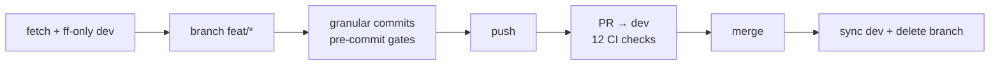

# Git Workflow

This project follows the **Gitflow branching model** (Vincent Driessen,
[A successful Git branching model](https://nvie.com/posts/a-successful-git-branching-model/),
plus the [official git workflows documentation](https://git-scm.com/docs/gitworkflows)),
adapted for a solo maintainer — and designed so the same model scales to a
team without changes. We use **plain git commands only**: no plugins, no
`git-flow` extension. Every command below is copy-pasteable.

## The five branch types

```mermaid
gitGraph
    commit id: "v1.1.0"
    branch dev
    checkout dev
    commit id: "work starts"
    branch feat/example
    checkout feat/example
    commit id: "feat: …"
    commit id: "test: …"
    checkout dev
    merge feat/example id: "PR merged"
    commit id: "more work"
    branch release/1.2.0
    checkout release/1.2.0
    commit id: "chore(release): bump"
    checkout main
    merge release/1.2.0 tag: "v1.2.0" id: "release PR"
    checkout dev
    merge main id: "merge-back"
    checkout main
    branch hotfix/urgent
    checkout hotfix/urgent
    commit id: "fix: urgent"
    checkout main
    merge hotfix/urgent tag: "v1.2.1" id: "hotfix PR"
    checkout dev
    merge main id: "merge-back"
```

| Branch | Created from | Merged into | Lifetime |
|---|---|---|---|
| `main` | — (permanent) | — | Permanent; production-ready; every merge is tagged |
| `dev` | — (permanent) | `release/*` → `main` | Permanent; integration for the next release |
| `feat/*` · `fix/*` · `docs/*` · `chore/*` · `ci/*` | `dev` | `dev` | Short-lived; deleted after merge |
| `release/X.Y.Z` | `dev` | `main` **and** back to `dev` | Lives only while the release is prepared |
| `hotfix/*` | `main` | `main` **and** back to `dev` | Lives only until the emergency patch ships |

**Naming rules:**

- `feat/<slug>` for features and defense layers, `fix/<slug>` for bugs,
  `docs/<slug>` for documentation-only, `chore/<slug>` for maintenance,
  `ci/<slug>` for workflow changes, `hotfix/<slug>` for emergencies,
  `release/X.Y.Z` (the literal version number) for releases.
- Slugs are lowercase kebab-case: `fix/dependabot-config`,
  `feat/phase-n-output-ux`.
- One branch = one deliverable = one PR. Granular commits inside the branch
  (1 commit = 1 intent).

## Daily work: the delivery choreography

**Every** contribution follows the same six steps. Skipping the first step
(fetch) was the root cause of a real incident (PR created on a stale `dev`,
blocked by "update branch" — see `DECISIONS.md` and
`.github/ai-lessons-learned.md`).

```bash
# 1. ALWAYS start from a fresh dev
git checkout dev
git fetch origin --no-tags --prune
git merge --ff-only origin/dev

# 2. Branch with the typed prefix
git checkout -b feat/my-change

# 3. Granular commits — the pre-commit hook runs the gates
git add <files> && git commit -m "feat(scope): …"

# 4. Gates before pushing
npm test && npm run lint
npm run defence:check-md-links   # if markdown changed

# 5. Push and open the PR against dev
git push -u origin feat/my-change

# 6. After the merge: clean up
git checkout dev && git merge --ff-only origin/dev
git branch -d feat/my-change
```



## Releases: the `release/X.Y.Z` branch

Releases get their own branch so that `dev` stays open for new work while
the release is stabilized (version bump, CHANGELOG, last-minute release
fixes). Release work runs in an **isolated git worktree** — never in the
shared checkout (ADR 2026-11-05).

```bash
# In an isolated worktree, from a fresh dev:
git worktree add ../release-1.2.0 -b release/1.2.0 origin/dev
cd ../release-1.2.0

# Stabilize: bump version, CHANGELOG [X.Y.Z] - YYYY-MM-DD, gates
npm pkg set version=1.2.0        # also package-lock.json
# …full release matrix (see docs/en/release-checklist.md)…

# PR: release/1.2.0 → main. After merge:
git checkout main && git pull --ff-only origin main
git tag -a v1.2.0 -m "Release v1.2.0"
git push origin v1.2.0

# Merge-back — main's tip must return to dev (ADR 2026-11-05):
git checkout dev && git pull --ff-only origin dev
git checkout -b chore/merge-back-v1.2.0
git merge --no-ff origin/main
git push -u origin chore/merge-back-v1.2.0   # PR → dev
```

Only release fixes (bump, changelog, a broken gate) belong on the
`release/*` branch. New features never do — they wait for the next cycle on
`dev`.

## Emergencies: the `hotfix/*` branch

A critical bug in the tagged production version (e.g. a defense gate that
wrongly blocks every install) cannot wait for the next release cycle. The
hotfix branches from `main`, patches, and returns everywhere:

```bash
git checkout main && git fetch origin --no-tags && git merge --ff-only origin/main
git checkout -b hotfix/age-gate-rejects-all

# …minimal fix + regression test + gates…
git push -u origin hotfix/age-gate-rejects-all   # PR → main

# After merge: patch release tag
git checkout main && git pull --ff-only origin main
git tag -a v1.2.1 -m "Hotfix v1.2.1 — what was broken"
git push origin v1.2.1

# Merge-back to dev (same intermediate-branch pattern as releases)
```

Rules: the hotfix contains **only** the emergency fix and its test —
everything else waits for the normal cycle. The merge-back to `dev` is
mandatory so the fix is not lost in the next release.

## Why no `git-flow` plugin

The model is a **convention, not a tool**. The plugin only wraps the exact
commands above, hides the merge directions, and adds an install-time
dependency that this project's own age/signature gates would have to vet.
Teaching the plain commands keeps the model portable: anyone with git —
including the projects that adopt our defenses via `install-defences.js` —
can follow it verbatim.

## Branch strategy

Open a feature branch from `dev`, push your commits, and open a pull request back to `dev`. When the release is ready, stabilize it on a `release/X.Y.Z` branch and merge it into `main` through a pull request.

## Branch protection (`main` and `dev`)

- **Push restriction:** code reaches either branch only through a pull request.
- **Required checks:** the 12 CI jobs defined in [`.github/workflows/ci.yml`](../../.github/workflows/ci.yml) must pass, and branches must be up to date before merging.
- **Code-owner review:** [`.github/CODEOWNERS`](../../.github/CODEOWNERS) requires the maintainer's review for critical paths (defence tools, hooks, workflows, npm configuration, AI customizations).
- **Solo-maintainer note:** the minimum *approving review count* is temporarily 0 (a solo maintainer cannot approve their own PRs); the CODEOWNERS path requirement and all status checks remain active. Recorded as an ADR in `DECISIONS.md`.

See [ci-cd-overview.md](ci-cd-overview.md) for the list of checks.

## Opening a pull request

1. Make sure the branch started from the latest `dev` (choreography step 1).
2. Run the pre-PR checklist below.
3. Open the PR against `dev` (or `main` for `release/*` and `hotfix/*`).
4. Wait for all required CI checks to turn green.

## Pre-PR checklist

```bash
npm test
npm run lint
npm run defence:check-md-links   # if markdown files changed
npm run defence:verify-defences
```

Also ensure the [`.husky/pre-commit`](../../.husky/pre-commit) hook ran successfully. It enforces `actionlint` locally when the binary is installed.

## When CI fails

- Click the failing check in the PR to read the logs.
- Fix the root cause locally; do not override checks.
- Push the fix and wait for CI to rerun.
- If a failure is caused by a transient network issue, re-run the specific failed job from the GitHub UI.
