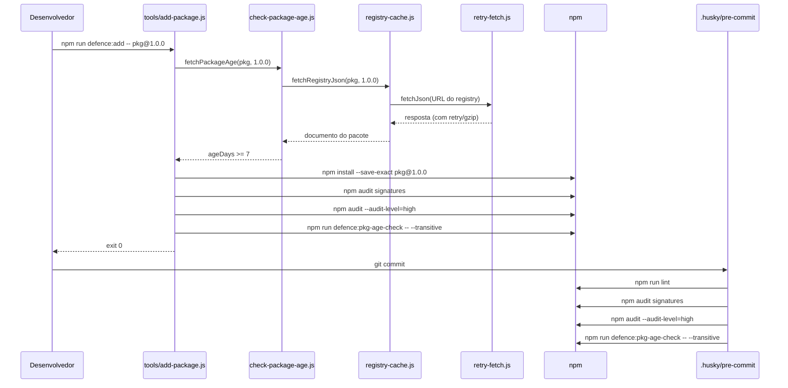

# Arquitetura

Este documento descreve a arquitetura de alto nível do projeto: como os arquivos, scripts, camadas de segurança e customizações de AI se encaixam.

## Estrutura do Repositório

```bash
.
├── .github/
│   ├── copilot-instructions.md       # Instruções AI sempre ativas (≤ 3 KB, orçamento com teste)
│   ├── instructions/                 # Instruções AI por escopo de arquivo (padrões applyTo)
│   ├── agents/                       # Agentes AI customizados (+ agents.sanity.test.js)
│   ├── skills/                       # Agent Skills (+ skills.sanity.test.js, índice gerado)
│   ├── hooks/                        # Hooks de lifecycle do Copilot (+ hooks.sanity.test.js, scripts/)
│   ├── workflows/ci.yml              # Pipeline de CI no GitHub Actions (11 jobs)
│   ├── CODEOWNERS                    # Defesa organizacional: revisão de code owner em paths críticos
│   ├── PLAN.md                       # Plano autoritativo (fonte da verdade das sessões)
│   ├── ai-lessons-learned.md         # Log de erros recorrentes de AI
│   └── ISSUE_TEMPLATE/               # Formulários de issue, incluindo gap de ferramenta de AI
├── .husky/
│   ├── pre-commit                    # Git hook executado em todo commit (protegido por hash)
│   └── post-merge                    # Hook que avisa quando node_modules está desatualizado
├── .npmrc                              # Defaults endurecidos do npm (protegido pelo check-npmrc)
├── .nvmrc                              # Versão fixada do Node.js (gerenciada pelo update-engines)
├── .defence-manifest.json              # Manifesto SHA-256 dos arquivos de defesa adotados
├── biome.json                          # Configuração de lint e formatação do Biome
├── package.json                        # Manifesto do projeto e scripts npm
├── package-lock.json                   # Árvore de dependências determinística
├── README.md                           # Documentação de entrada
├── CHANGELOG.md                        # O que mudou (Keep a Changelog)
├── CONTRIBUTING.md                     # Fluxo do contribuidor e regra de granularidade de commits
├── DECISIONS.md                        # ADRs — por que cada caminho foi escolhido
├── SECURITY.md                         # Política de segurança
├── TODO.md                             # Rastreador de checkboxes espelhando o PLAN.md
├── docs/                               # Documentação multilíngue (en, pt-BR)
└── tools/                              # Scripts de defesa e testes
    ├── add-package.js                #   wrapper controlado de npm install
    ├── analyze-lifecycle-scripts.js  #   análise de risco de lifecycle scripts
    ├── check-dead-code.js            #   localizador consultivo de código morto
    ├── check-engines.js              #   validação de runtime vs engines
    ├── check-external-urls.js        #   alcançabilidade de URLs externas
    ├── check-hooks.js                #   integridade do pre-commit (hash)
    ├── check-licenses.js             #   listas de licenças permitidas/proibidas
    ├── check-lockfile-integrity.js   #   força dos hashes do lockfile
    ├── check-md-links.js             #   validação de links markdown
    ├── check-npmrc.js                #   guarda da superfície de configuração do npm
    ├── check-package-age.js          #   idade mínima de pacotes
    ├── check-secrets.js              #   varredura de segredos
    ├── check-sync.js                 #   sincronia node_modules vs lockfile
    ├── check-updates.js              #   classificação de updates (elegível/quarentena)
    ├── generate-sbom.js              #   SBOM CycloneDX
    ├── generate-trust-report.js      #   pontuação de confiança de dependências
    ├── install-defences.js           #   instalador de adoção + manifesto
    ├── integration.test.js           #   testes de integração entre ferramentas
    ├── monitor-install.js            #   wrapper de install monitorado
    ├── run-audit-with-retry.js       #   npm audit com retry de falhas transitórias
    ├── setup-bootstrap.js            #   bootstrap da primeira instalação
    ├── update-badge.js               #   badge de contagem de testes no README
    ├── update-engines.js             #   update/upgrade de engines (gateado pelo índice dist)
    ├── update-packages.js            #   wrapper controlado de npm update
    ├── verify-defences.js            #   verificação do manifesto
    ├── e2e/                          #   harness end-to-end (local do repo, não adotado)
    ├── perf/                         #   benchmarks e baselines
    └── lib/                          #   módulos compartilhados (responsabilidade única cada)
        ├── concurrency.js            #     executor de concorrência limitada
        ├── config.js                 #     carregador centralizado de configuração
        ├── install-monitor-report.js #     construtores de relatório do install monitorado
        ├── package-utils.js          #     parsing de especificadores de pacote
        ├── process-monitor.js        #     instrumentação de processos filhos (DI)
        ├── profiler.js               #     wrapper de profiling de performance
        ├── provenance.js             #     helpers de provenance/SLSA
        ├── registry-cache.js         #     cache em disco do registry
        ├── retry-fetch.js            #     fetch com gzip, limites e retry/backoff
        ├── script-analyzer.js        #     padrões de risco de lifecycle scripts
        ├── semver.js                 #     comparação semver mínima (X.Y.Z)
        ├── sync-check.js             #     lógica de sincronia node_modules/lockfile
        ├── trust-engine.js           #     pesos e cálculo do score de confiança
        └── typosquatting.js          #     helpers de detecção de typosquat
```

Todo arquivo de produção tem um `<nome>.test.js` colocado ao lado; as suítes em
`.github/` (agents, skills, hooks) protegem a própria superfície de customização de AI.

## Componentes

| Componente | Responsabilidade |
| --- | --- |
| `package.json` | Declara dependências, scripts, engines e blocos de configuração (`pkgAgeCheck`, `updateCheck`, `updateEngines`, `licensesCheck`, `typosquattingCheck`, `defences`). |
| `.npmrc` | Impõe `save-exact`, `ignore-scripts`, `min-release-age=7`, `audit-level=high`, etc. — chaves validadas pelo `check-npmrc`. |
| `.husky/pre-commit` | Dispara varredura de segredos, integridade de hook, superfície npmrc, lint, URLs externas, atualização de manifesto e badge, auditoria de assinaturas, auditoria de vulnerabilidades, checagem transitiva de idade e checagem de licenças antes de cada commit. |
| `.husky/post-merge` | Avisa quando `node_modules` fica fora de sincronia após `git pull` ou `git merge`. |
| `.github/workflows/ci.yml` | Executa os jobs build, test, coverage, lint, format, links de docs, licenças, integridade do lockfile, varredura de segredos, dry-run do instalador e defence gates em toda PR e push. |
| `.github/CODEOWNERS` | Exige revisão de code owner para `tools/`, hooks, workflows, configuração npm e a superfície de customização de AI. |
| `tools/check-engines.js` | Valida as versões ativas de Node.js e npm contra `engines`. |
| `tools/update-engines.js` | Reporta e aplica updates/upgrades de engine, gateando alvos no índice oficial de dist do Node.js (disponibilidade no CI por construção). |
| `tools/check-npmrc.js` | Valida as chaves do `.npmrc` (lista de conhecidas + lookahead documentado) e rejeita o mecanismo de extensão do npm v12. |
| `tools/check-dead-code.js` | Localizador consultivo de candidatos a código morto (nunca um gate rígido). |
| `tools/check-package-age.js` | Consulta o registry do npm para impor a idade mínima de pacotes. |
| `tools/check-updates.js` | Avisa sobre atualizações disponíveis e as classifica como elegíveis ou em quarentena, descobrindo versões intermediárias elegíveis por idade. |
| `tools/add-package.js` | Wrapper controlado de `npm install` que executa checagens de idade, assinatura, auditoria, licença e transitivas. |
| `tools/setup-bootstrap.js` | Executa a primeira instalação quando `package-lock.json` não existe. |
| `tools/update-packages.js` | Wrapper controlado de `npm update` com alvos intermediários fixados e aprovação interativa opcional. |
| `tools/update-badge.js` | Atualiza o badge de contagem de testes no `README.md` (globs espelham o script `npm test`). |
| `tools/check-licenses.js` | Varre licenças de dependências contra listas de permitidas/proibidas. |
| `tools/check-sync.js` | Comando standalone que verifica se `node_modules` corresponde ao `package-lock.json`. |
| `tools/check-lockfile-integrity.js` | Verifica se toda entrada do lockfile tem hash de integridade forte. |
| `tools/check-hooks.js` | Verifica o `.husky/pre-commit` contra o hash conhecido no `package.json`. |
| `tools/check-secrets.js` | Varre arquivos em busca de prováveis segredos antes do commit. |
| `tools/check-md-links.js` | Valida links markdown internos e externos. |
| `tools/check-external-urls.js` | Valida alcançabilidade de URLs externas com cache e allow-list. |
| `tools/generate-sbom.js` | Gera SBOM CycloneDX 1.4 JSON a partir do `package-lock.json`. |
| `tools/generate-trust-report.js` | Pontua dependências com o trust engine (idade, cadência, downloads, provenance, typosquatting, risco de lifecycle, licença). |
| `tools/analyze-lifecycle-scripts.js` | Análise estática de risco dos lifecycle scripts de um pacote antes da adoção. |
| `tools/monitor-install.js` | Wrapper de install que instrumenta processos filhos via `lib/process-monitor.js`. |
| `tools/run-audit-with-retry.js` | Wrapper de `npm audit` com retry de falhas transitórias. |
| `tools/install-defences.js` | Copia as defesas para outro projeto Node.js e escreve o `.defence-manifest.json`; um teste de completude garante que todo arquivo de `tools/` seja adotado ou explicitamente excluído. |
| `tools/verify-defences.js` | Verifica os arquivos copiados contra o `.defence-manifest.json`. |
| `tools/lib/config.js` | Carregador centralizado de configuração (package.json + overrides opcionais). |
| `tools/lib/concurrency.js` | Executor compartilhado de concorrência limitada usado pelas ferramentas paralelas de registry. |
| `tools/lib/registry-cache.js` | Cache em disco de respostas do registry, compartilhado pelas ferramentas que consultam o npm. |
| `tools/lib/retry-fetch.js` | Camada compartilhada de fetch com suporte a gzip, limites de tamanho e retry/backoff. |
| `tools/lib/sync-check.js` | Verifica se `node_modules` corresponde ao `package-lock.json`. |
| `tools/lib/package-utils.js` | Helpers compartilhados de parsing de especificadores de pacote. |
| `tools/lib/semver.js` | Comparação mínima de X.Y.Z compartilhada pelas ferramentas de engine (extraída pela regra do segundo consumidor byte-idêntico). |
| `tools/lib/provenance.js` | Helpers para provenance npm e verificação de atestação SLSA. |
| `tools/lib/script-analyzer.js` | Padrões de risco e agregação para análise de lifecycle scripts. |
| `tools/lib/trust-engine.js` | Pesos, limites e cálculo do score de confiança de dependências. |
| `tools/lib/typosquatting.js` | Helpers de detecção de typosquat (similaridade de nome, sinais de confusão). |
| `tools/lib/process-monitor.js` | Instrumentação injetável de processos filhos para installs monitorados. |
| `tools/lib/install-monitor-report.js` | Construtores de relatório da saída do install monitorado. |
| `tools/lib/profiler.js` | Wrapper `withProfile` alimentando os benchmarks de `tools/perf/`. |
| `biome.json` | Configura o Biome como linter e formatador sobre `tools/`, `.github/` e JS da raiz. |

## Camada de Customização de AI

A superfície de AI do repositório tem cinco camadas, ordenadas da sempre ativa
à sob demanda. Onde uma regra nova se encaixa depende do seu escopo:

| Camada | Local | Ativa quando | Use para |
| --- | --- | --- | --- |
| **Instruções sempre ativas** | `.github/copilot-instructions.md` | Toda requisição (orçamento ≤ 3 KB, com teste) | Regras universais que toda sessão deve seguir (gates de segurança, política de dependências, granularidade de commits, docs bilíngues). |
| **Instruções com escopo** | `.github/instructions/*.instructions.md` | Arquivos correspondem ao glob `applyTo` | Regras de domínio para uma classe de arquivos (shell scripts, testes, docs, config de segurança). |
| **Skills** | `.github/skills/<nome>/SKILL.md` | Modelo carrega por relevância, ou usuário invoca via `/` | Procedimentos repetíveis e conhecimento empacotado (passes de revisão, checklist de release, hash sync). |
| **Agents** | `.github/agents/*.agent.md` | Tarefas delegadas a subagentes | Revisão especializada por domínio com ferramentas restritas e raio de impacto `applyTo` visível. |
| **Hooks** | `.github/hooks/*.json` + `scripts/` | Eventos de lifecycle (início de sessão, pré/pós uso de ferramenta) | Garantias determinísticas e conselhos que não podem depender do julgamento do modelo (bloqueios de segurança, write guard, advertência de commit grande). |

Regra prática de decisão: uma *orientação* vai para instructions; um
*procedimento* vai para uma skill; um *revisor especialista* vai para um
agent; uma *garantia* vai para um hook. A memória do projeto vive em arquivos
versionados (`PLAN.md`, `TODO.md`, `DECISIONS.md`,
`.github/ai-lessons-learned.md`) — recursos de memória em nuvem são tratados
como caches voláteis (ver [diretrizes de AI](ai-guidelines.md)).

As três suítes — `agents.sanity.test.js`, `skills.sanity.test.js` e
`hooks.sanity.test.js` — rodam no `npm test`, então uma customização
malformada falha ruidosamente no CI em vez de ser silenciosamente ignorada
pelo editor.

## Fluxo de Adição de Dependência



## Camada Compartilhada de Registry

As ferramentas que consultam o registry do npm (`check-package-age.js`, `check-updates.js`) não chamam `https.get` diretamente. Elas passam por dois módulos compartilhados:

- **`tools/lib/retry-fetch.js`** — gerencia HTTPS, descompressão gzip, limite de tamanho de resposta e retry com backoff exponencial. Faz retry apenas em erros de rede e nos códigos HTTP `429`, `502`, `503`, `504`; outras falhas (por exemplo, `404`, JSON inválido) falham rápido para evitar loops infinitos. A mesma camada busca o índice dist do Node.js para o `update-engines.js`.
- **`tools/lib/registry-cache.js`** — armazena em disco, em `.cache/registry/`, respostas bem-sucedidas do registry indexadas por `name@version`. As entradas respeitam um TTL configurável, podem ser ignoradas com `force: true` e são totalmente desabilitadas quando a variável de ambiente `DEFENCE_NO_CACHE=1` está definida.

Esse design mantém o comportamento de rede consistente, reduz chamadas repetidas ao registry e faz com que todos os consumidores se beneficiem automaticamente de melhorias de performance e resiliência.

## Decisões de Design

- **Apenas módulos nativos do Node.js** nos scripts de tooling, para que possam rodar antes de qualquer dependência estar instalada.
- **Padrão de injeção** (`setImpls` / `resetImpls` e afins) torna os scripts testáveis sem executar comandos reais do `npm`.
- **Camada compartilhada de fetch/cache** centraliza retry, gzip e cache para que nenhuma ferramenta precise reimplementá-los.
- **Prefixo defence:*** agrupa todos os scripts relacionados à segurança e reduz o atrito ao adotar as defesas em outros projetos.
- **Consultivo vs. gate:** ferramentas de análise que não conseguem provar uma negação (código morto, disponibilidade de updates) reportam candidatos e nunca bloqueiam; gates de enforcement (idade, assinaturas, licenças, superfície npmrc, integridade de hook) falham ruidosamente. A divisão está registrada em `DECISIONS.md`.
- **Adoção dirigida por manifesto:** o `install-defences.js` copia uma lista curada de arquivos e registra hashes SHA-256; um teste de completude falha quando um novo arquivo de ferramenta não é adotado nem explicitamente excluído.
- **Regra de extração:** módulos compartilhados existem apenas para código byte-idêntico com múltiplos consumidores (ver o histórico de `concurrency.js`/`semver.js` em `DECISIONS.md`).
