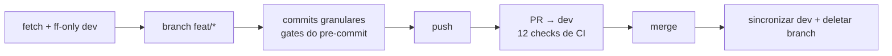

# Fluxo de trabalho Git

Este projeto segue o **modelo de branching Gitflow** (Vincent Driessen,
[A successful Git branching model](https://nvie.com/posts/a-successful-git-branching-model/),
mais a [documentação oficial de workflows do git](https://git-scm.com/docs/gitworkflows)),
adaptado para um mantenedor solo — e desenhado para escalar para um time sem
mudanças. Usamos **apenas comandos git puros**: sem plugins, sem a extensão
`git-flow`. Todos os comandos abaixo são copiáveis e coláveis.

## Os cinco tipos de branch

```mermaid
gitGraph
    commit id: "v1.1.0"
    branch dev
    checkout dev
    commit id: "trabalho começa"
    branch feat/exemplo
    checkout feat/exemplo
    commit id: "feat: …"
    commit id: "test: …"
    checkout dev
    merge feat/exemplo id: "PR mergeada"
    commit id: "mais trabalho"
    branch release/1.2.0
    checkout release/1.2.0
    commit id: "chore(release): bump"
    checkout main
    merge release/1.2.0 tag: "v1.2.0" id: "PR de release"
    checkout dev
    merge main id: "merge-back"
    checkout main
    branch hotfix/urgente
    checkout hotfix/urgente
    commit id: "fix: urgente"
    checkout main
    merge hotfix/urgente tag: "v1.2.1" id: "PR de hotfix"
    checkout dev
    merge main id: "merge-back"
```

| Branch | Criada a partir de | Mergeada em | Vida útil |
|---|---|---|---|
| `main` | — (permanente) | — | Permanente; pronta para produção; todo merge é tagueado |
| `dev` | — (permanente) | `release/*` → `main` | Permanente; integração da próxima release |
| `feat/*` · `fix/*` · `docs/*` · `chore/*` · `ci/*` | `dev` | `dev` | Curta duração; deletada após o merge |
| `release/X.Y.Z` | `dev` | `main` **e** de volta para `dev` | Vive apenas enquanto a release é preparada |
| `hotfix/*` | `main` | `main` **e** de volta para `dev` | Vive apenas até o patch de emergência ser publicado |

**Regras de nomenclatura:**

- `feat/<slug>` para features e camadas de defesa, `fix/<slug>` para bugs,
  `docs/<slug>` para somente documentação, `chore/<slug>` para manutenção,
  `ci/<slug>` para mudanças de workflow, `hotfix/<slug>` para emergências,
  `release/X.Y.Z` (o número literal da versão) para releases.
- Slugs em kebab-case minúsculo: `fix/dependabot-config`,
  `feat/phase-n-output-ux`.
- Uma branch = uma entrega = uma PR. Commits granulares dentro da branch
  (1 commit = 1 intenção).

## Trabalho diário: a coreografia de entrega

**Toda** contribuição segue os mesmos seis passos. Pular o primeiro passo
(fetch) foi a causa raiz de um incidente real (PR criada sobre uma `dev`
desatualizada, bloqueada pelo "update branch" — ver `DECISIONS.md` e
`.github/ai-lessons-learned.md`).

```bash
# 1. SEMPRE comece de uma dev atualizada
git checkout dev
git fetch origin --no-tags --prune
git merge --ff-only origin/dev

# 2. Crie a branch com o prefixo tipado
git checkout -b feat/minha-mudanca

# 3. Commits granulares — o pre-commit roda os gates
git add <arquivos> && git commit -m "feat(escopo): …"

# 4. Gates antes do push
npm test && npm run lint
npm run defence:check-md-links   # se arquivos markdown foram alterados

# 5. Push e abertura da PR contra dev
git push -u origin feat/minha-mudanca

# 6. Após o merge: limpeza
git checkout dev && git merge --ff-only origin/dev
git branch -d feat/minha-mudanca
```



## Releases: a branch `release/X.Y.Z`

Releases ganham branch própria para que a `dev` continue aberta a novos
trabalhos enquanto a release é estabilizada (bump de versão, CHANGELOG,
correções de última hora da release). O trabalho de release roda numa
**git worktree isolada** — nunca no checkout compartilhado
(ADR 2026-11-05).

```bash
# Numa worktree isolada, a partir de uma dev atualizada:
git worktree add ../release-1.2.0 -b release/1.2.0 origin/dev
cd ../release-1.2.0

# Estabilizar: bump de versão, CHANGELOG [X.Y.Z] - AAAA-MM-DD, gates
npm pkg set version=1.2.0        # também package-lock.json
# …matriz completa de release (ver docs/pt-BR/release-checklist.md)…

# PR: release/1.2.0 → main. Após o merge, tag a partir da main mergeada:
# tags são enviadas por push, não por merge — a proteção de branches não as
# bloqueia (foi assim que v1.0.0 e v1.1.0 foram publicadas).
git checkout main && git pull --ff-only origin main
git tag -a v1.2.0 -m "Release v1.2.0"
git push origin v1.2.0

# Merge-back — a ponta da main deve voltar para a dev (ADR 2026-11-05):
git checkout dev && git pull --ff-only origin dev
git checkout -b chore/merge-back-v1.2.0
git merge --no-ff origin/main
git push -u origin chore/merge-back-v1.2.0   # PR → dev
```

Somente correções da release (bump, changelog, um gate quebrado) pertencem
à branch `release/*`. Features novas, nunca — elas esperam o próximo ciclo
na `dev`.

## Emergências: a branch `hotfix/*`

Um bug crítico na versão tagueada em produção (ex.: um gate de defesa que
bloqueia indevidamente toda instalação) não pode esperar o próximo ciclo de
release. O hotfix nasce da `main`, corrige e retorna para todos os lados:

```bash
git checkout main && git fetch origin --no-tags && git merge --ff-only origin/main
git checkout -b hotfix/age-gate-rejeita-tudo

# …correção mínima + teste de regressão + gates…
git push -u origin hotfix/age-gate-rejeita-tudo   # PR → main

# Após o merge: tag de patch. Tags são enviadas por push, não por merge —
# o ruleset de proteção de branches não bloqueia push de tags (foi assim
# que v1.0.0 e v1.1.0 foram publicadas).
git checkout main && git pull --ff-only origin main
git tag -a v1.2.1 -m "Hotfix v1.2.1 — o que estava quebrado"
git push origin v1.2.1

# Merge-back para a dev (mesmo padrão de branch intermediária das releases)
```

Regras: o hotfix contém **somente** a correção de emergência e seu teste —
todo o resto espera o ciclo normal. O merge-back para a `dev` é obrigatório
para que a correção não se perca na próxima release.

## Por que não usar o plugin `git-flow`

O modelo é uma **convenção, não uma ferramenta**. O plugin apenas embrulha
exatamente os comandos acima, esconde as direções de merge e adiciona uma
dependência de instalação que os próprios gates de idade/assinatura deste
projeto teriam que avaliar. Ensinar os comandos puros mantém o modelo
portável: qualquer pessoa com git — inclusive os projetos que adotam nossas
defesas via `install-defences.js` — consegue segui-lo literalmente.

## Estratégia de branches

Abra uma branch de feature a partir de `dev`, envie seus commits e abra um
pull request de volta para `dev`. Quando a release estiver pronta,
estabilize-a numa branch `release/X.Y.Z` e faça o merge em `main` através de
um pull request.

## Proteção de branches (`main` e `dev`)

- **Restrição de push:** código só chega a qualquer uma das branches por meio de pull request.
- **Checks obrigatórios:** os 12 jobs de CI definidos em [`.github/workflows/ci.yml`](../../.github/workflows/ci.yml) devem passar, e as branches precisam estar atualizadas antes do merge.
- **Revisão de code owner:** o [`.github/CODEOWNERS`](../../.github/CODEOWNERS) exige a revisão do mantenedor para paths críticos (ferramentas de defesa, hooks, workflows, configuração npm, customizações de AI).
- **Nota de mantenedor solo:** o número mínimo de *aprovações* está temporariamente em 0 (um mantenedor solo não pode aprovar as próprias PRs); a exigência de CODEOWNERS por path e todos os status checks permanecem ativos. Registrado como ADR em `DECISIONS.md`.
- **Sem restrição de branch de origem nas PRs, por design:** o ruleset da `main` exige pull request mas NÃO restringe de qual branch ela vem. `release/*` e `hotfix/*` precisam mirar a `main` diretamente, e a defesa não mora na branch de origem — mora no funil que toda PR atravessa: 12 checks verdes, revisão CODEOWNERS dos paths críticos e zero push direto. Uma branch hostil ou descuidada atinge os mesmos gates, independente do nome.
- **Inventário do ruleset** (configurações exatas e a armadilha do "Restrict updates"): ver [repository-organization.md](repository-organization.md).
- **Inventário do ruleset** (configurações exatas e a armadilha do
  "Restrict updates"): ver [repository-organization.md](repository-organization.md).

Consulte [ci-cd-overview.md](ci-cd-overview.md) para a lista de verificações.

## Abrindo um pull request

1. Garanta que a branch nasceu da `dev` mais recente (passo 1 da coreografia).
2. Execute a lista de verificação pré-PR abaixo.
3. Abra o PR contra `dev` (ou `main` para `release/*` e `hotfix/*`).
4. Aguarde todos os checks obrigatórios do CI ficarem verdes.

## Checklist pré-PR

```bash
npm test
npm run lint
npm run defence:check-md-links   # se arquivos markdown foram alterados
npm run defence:verify-defences
```

Certifique-se também de que o hook [`.husky/pre-commit`](../../.husky/pre-commit) foi executado com sucesso. Ele impõe o `actionlint` localmente quando o binário está instalado.

## Quando o CI falha

- Clique no check que falhou no PR para ler os logs.
- Corrija a causa raiz localmente; não ignore os checks.
- Envie a correção e aguarde o CI reexecutar.
- Se a falha for causada por um problema transitório de rede, reexecute o job específico pela interface do GitHub.
